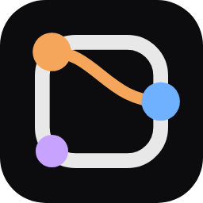

<p align="center"></p>

# つなぎ

**日本語で書くプログラミング言語「をこと」で、ゲームやアプリを作るエディタ。**

左に文を書くと、右ですぐにゲームが動きます。画面の中のものをクリックすると、それを動かしている文が光ります（画面と文が「つながる」）。

```
ねこ という 丸 を 作る。
ねこ に 重力 を 1500 だけ かける。
スペース を 押したら、ねこ を 200 だけ ジャンプ させる。
```

> このリポジトリは、つなぎを**配るためのもの**です（インストーラーと使い方だけを置いています）。

## 入れる（Windows）

👉 **https://github.com/RayOguma/Tsunagi/releases/latest**

1. 「Assets」の中の `tsunagi-setup-<版>.exe` をダウンロードして開きます。
2. 「Windows によって PC が保護されました」と出たら、「詳細情報」→「実行」を押します（お金をかけた「署名」をしていないアプリなので出ます）。
3. 入れる場所を選んで入れると、デスクトップに「つなぎ」のアイコンができます。

- 新しい版が出たら、起動したときに自動で取ってきて、入れ替えるかを聞きます。保存していない文があるときは、入れ替える前に聞きます。

## はじめかた

1. つなぎを起動して、「**フォルダを開く**」（<kbd>Ctrl</kbd>+<kbd>O</kbd>）で、作品を置くフォルダを選びます（空のフォルダでかまいません）。
2. 「ファイル」→「**新しいファイル**」（<kbd>Ctrl</kbd>+<kbd>N</kbd>）で、`.wokoto` のファイルを作ります。
3. 左に をこと の文を書きます。書いて少し手を止めると、右のゲームがはじめから動き直します。
4. 右のゲームをクリックしてから、キーで遊べます。
5. <kbd>Ctrl</kbd>+<kbd>S</kbd> で保存します。

書きまちがえると、下の「問題」に、何行目がどうおかしいかが出ます。そのあいだも、ゲームは前のまま動いています。

## 画面

| 場所 | すること |
| --- | --- |
| 左（サイドバー） | 開いたフォルダのファイル。`.wokoto` のほか、文字のファイル（`.md` `.txt` など）を書き直したり、絵（`.png` など）や音（`.mp3` など）を見たり聞いたりできます |
| まん中（エディタ） | 文を書くところ。文の色は、言葉の役目（だれが・何を・どこへ・どれだけ・どうする）ごとの色です。言葉にマウスを乗せると説明が出て、書いている途中で候補も出ます |
| 右（実行プレビュー） | ゲームが動くところ |
| 下（パネル） | 問題・出力・記録・もの（画面にあるものの一覧） |

### 画面と文がつながる

<kbd>F6</kbd> でゲームを一時停止して、画面の中のものをクリックすると、そのものを動かしている文が光ります。カーソルを置いた文が関わっているものにも、枠が付きます。

### よく使うキー

| キー | すること |
| --- | --- |
| <kbd>Ctrl</kbd>+<kbd>S</kbd> | 保存 |
| <kbd>F5</kbd> | ゲームを始め直す |
| <kbd>F6</kbd> | 一時停止／再開 |
| <kbd>Ctrl</kbd>+<kbd>F</kbd> ／ <kbd>Ctrl</kbd>+<kbd>H</kbd> | 検索／置換 |
| <kbd>Ctrl</kbd>+<kbd>/</kbd> | コメント（`#`）の付け外し |
| <kbd>Ctrl</kbd>+<kbd>,</kbd> | 設定を開く |

## をこと の書き方

文の書き方は、ゲーム「ねこと」の説明ページにまとめています。

👉 [**をこと の書き方**](https://github.com/RayOguma/Nekoto/blob/main/%E3%82%92%E3%81%93%E3%81%A8%E3%81%AE%E6%9B%B8%E3%81%8D%E6%96%B9.md)

- 言葉と言葉の間は、スペースで区切ります。文の最後には「。」をつけます。
- 「を」「に」「だけ」などの助詞で、言葉の役目が決まります。
- 作れるもの：ランゲームや横スクロールのゲーム、ボタンや一覧のあるアプリ（買い物リストなど）、場面の切り替え、絵と音、記録（閉じても消えない値）など。

## 絵と音

作品のファイルと同じフォルダ（か、その上のフォルダ）に「**絵**」「**音**」というフォルダを作って入れると、文から使えます。

```
ねこ の 絵 を 「ねこ.png」 に する。
「曲.mp3」 を 何度も 鳴らす。
```

## 作ったゲームを配る

「ファイル」→「**ゲームを書き出す…**」で、つなぎがなくても遊べる Web ページのフォルダ（`index.html`、絵、音）を作れます。`index.html` をダブルクリックしても遊べますし、そのまま Web に置くこともできます。

## 設定

「ファイル」→「設定を開く」（<kbd>Ctrl</kbd>+<kbd>,</kbd>）。設定も をこと の文で書きます。

```
テーマ を 夜 に する。
文字 の 大きさ を 18 に する。
音楽 の 音量 を 50 に する。
```

テーマは、夜・藤・紙・海・桜・向日葵 から選べます。「表示」のメニューから選ぶこともできます。

## つなぎ で作ったゲーム

- 🐾 **[ねこと](https://github.com/RayOguma/Nekoto)**：日本語の文を書き換えて、ねこを旗まで連れていくゲーム（[ブラウザで遊ぶ](https://rayoguma.github.io/Nekoto/)）

---

作った人：RayOguma
